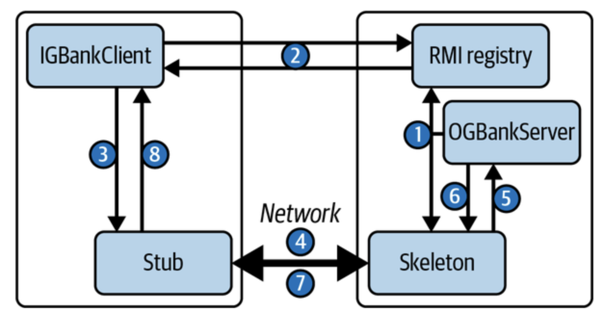

# Data Encoding
It is a translation between in-memory representation of data and self-contained sequence of bytes that can be sent over network.
- Language-specific formats: Java(java.io.Serializable), Python(pickle)
	- Incompatible for other languages
	- No versioning
- JSON, XML
	- Standardized encoding
	- XML is verbose, JSON does not have floating point precision
- Protocol Buffers
	- binary encoding
	- Requires a schema
	- Uses tag instead of field names in encoded data and thus, provides backward and forward compatibility.
- Avro
	- Uses writer's and reader's schema
	- Records can contain version number of schema version that it is encoded with.

# Data Evolution
## Database Schema
- Relational: One schema is active at a time. All data conforms to one schema. The schema can change using DDL.
- NoSQL: It is schema-less database so different versions of data formats can be written in the same database.

## Network Communication Schema
New and old versions of data formats might coexist at the same time.
- Rolling upgrade of a service
- Some clients have not installed the update of the app.
**Compatibility**
- Backward compatibility: Ensures that newer code can read data written by older code
- Forward compatibility: Ensures that older code can read data written by newer code

# Network Communication

## Data Transmission
There are four layers of protocols and each layer builds upon the layer that is beneath it.

### Application Layer
- HTTP and REST: Clients(and servers) can connect to servers to make requests to server's API.
	- Clients can be web browsers, native apps.
	- Predefined schemas for inputs and outputs of APIs.
	- REST emphasizes simple data formats, using URLs for identifying resources and using HTTP features for cache control, authentication, and content type negotiation
	- Service developers often use an IDL to define and document their service’s API endpoints and data models, and to evolve them over time. Other developers can then use the service definition to determine how to query the service.
- Remote Procedure Call(or RMI)
	- Request to remote service looks like calling a local function
	- Define the explicit server interface and call them across the network just like a method call in sequential code.
	- Provides location transparency with registry
	- RPC interface can be defined in IDLs. The `Stub` and `Skeleton` are objects generated by the compiler from the RMI interface definition, and these facilitate the actual remote communications. The skeleton is in fact a TCP network endpoint (_host, port_) that listens for calls to the associated server.
	- gRPC (Protocol Buffers) and Avro RPC
	- Marshalling and unmarshalling can become inefficient for complex object parameters. Cross-language marshalling—client in one language, server in another—can cause problems

### Transport Layer
It consists of protocols that ensures best-effort delivery of data.
Protocols:
- TCP: connection-oriented protocol. Before any messages are exchanged between applications, TCP uses a three-step handshake to establish a two-way connection between the client and server applications.
	- To achieve reliable packet delivery, TCP uses a cumulative acknowledgment mechanism.
- UDP: connectionless protocol, which exposes the user’s program to any unreliability of the underlying network.

A socket is one endpoint of a two-way network connection between a client and a server. Sockets are identified by a combination of the node’s IP address and an abstraction known as a _port_.

### Network Layer
Data is transmitted from source to destination using IP protocol. It consists of addressing and routing protocols.
IP defines how addresses are assigned to the nodes(IPv4 and IPv6)

- Routers: They are the devices that help in transmitting the data from source to destination. They receive the data from one network connect and place it on other network based on its destination
- DNS: resolves domain name to IP addresses. Described [here](../02BuildingBlocks/DNS.md).

Armed with a destination IP address, a host can start sending data across the network as a series of IP data packets.  
It does not attempt to compensate for the various error conditions

### Physical Layer
It manages the transmission of data in a single network segment, from node A to node B.
Network often comprises of heterogeneous machines, with different types of communication channels.
- Wired
  - LAN: Connect devices at small scale
  - WAN: traverses globe and make up the internet, using high speed fiber optics data pipelines 
- Wireless
  - Wireless Ethernet networks that use 802.11 protocol for transmission.
  - Cellular uses radio waves to transmit data between phone and cell towers that are connected through wire to the internet.

