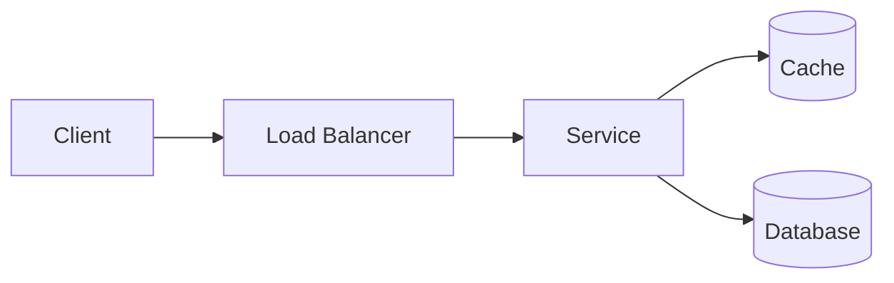

# <System name>: Design

## 1. Requirements
**Functional**
- ...

**Non-functional**
| Attribute | Target |
|---|---|
| Scale (DAU / peak QPS) | |
| Read:write ratio | |
| Latency (p99) | |
| Availability | |
| Consistency | |
| Data size / growth | |

**Assumptions**
- ...

## 2. Capacity estimates
Show the arithmetic for QPS, storage, bandwidth, and cache size.

## 3. API
| Operation | Interface (REST/RPC/event) | Request | Response |
|---|---|---|---|

## 4. Data model
Entities, storage choice and why, partition/shard key, and indexes.

## 5. High-level architecture

Walk through the read path and the write path.

## 6. Key decisions
| Decision | Options considered | Choice | Trade-off | Reference |
|---|---|---|---|---|

## 7. Scaling & reliability
Bottlenecks, hot spots, failure modes and mitigations, failover, and backpressure.

## 8. Security & operations
Authn/authz, encryption, tenancy isolation, observability, and deployment.

## 9. Trade-offs, risks & evolution
What was traded away, the open risks, and what changes at 10x scale.
